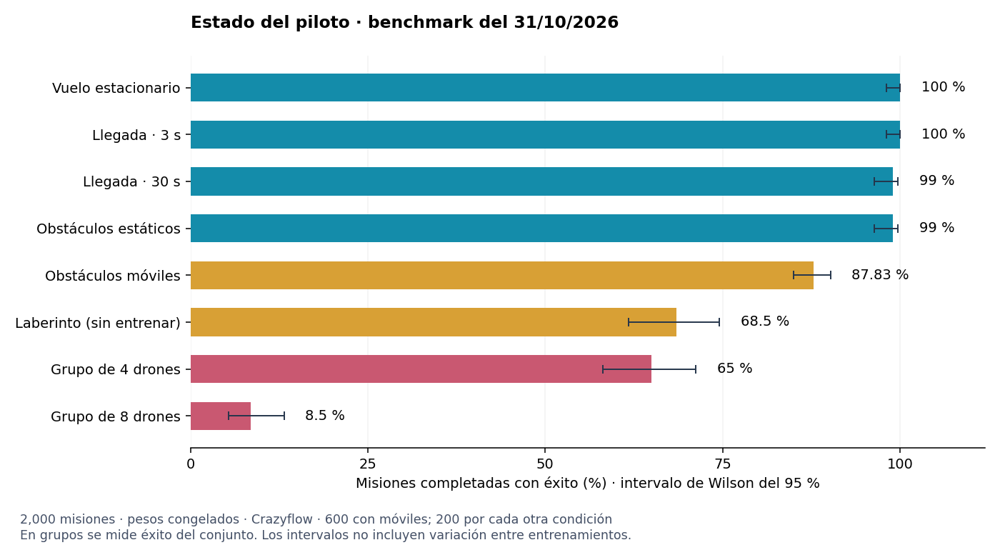

# Neuro Dron

Proyecto de investigación para entrenar drones autónomos mediante una implementación adaptada de **EGGROLL**, el método presentado en [Evolution Strategies at the Hyperscale](https://eshyperscale.github.io/).


*Vuelo del modelo de referencia en Crazyflow, visualizado con MuJoCo. Pesos congelados, sensores simulados y control directo de los motores.*

El objetivo es construir una base de entrenamiento que permita experimentar con una gama amplia de tamaños de red neuronal: desde modelos pequeños, adecuados para hardware limitado, hasta modelos grandes con los que explorar comportamientos más complejos. La motivación personal detrás del proyecto es crear un dron **lo más barato, pequeño, ágil y autónomo posible**.

**El proyecto está en desarrollo y actualmente se encuentra en la primera fase: entrenamiento en Crazyflow. La integración con un dron real y el perfeccionamiento en un simulador más realista siguen pendientes.**

## Motivación y método

Las estrategias evolutivas evalúan variaciones de los parámetros de una red y utilizan sus recompensas para actualizar el modelo. Permiten optimizar el comportamiento sin propagar gradientes a través del simulador.

[EGGROLL](https://eshyperscale.github.io/) introduce perturbaciones de bajo rango para reducir el coste de evaluar grandes poblaciones de modelos. El trabajo de referencia muestra mejoras importantes de eficiencia frente a estrategias evolutivas convencionales, especialmente con modelos grandes. Esa escalabilidad motiva su aplicación aquí, manteniendo también la posibilidad de entrenar redes pequeñas.

La implementación de este repositorio combina perturbaciones de bajo rango, pares de perturbaciones opuestas, recompensas transformadas por rango y actualizaciones con Adam. La mejora de rendimiento concreta en este entorno de drones debe medirse experimentalmente; los resultados del trabajo original no constituyen resultados de este proyecto.

## Del simulador al dron real

El flujo de desarrollo previsto es:

```text
Crazyflow
    ↓
Integración y pruebas en un dron real
    ↓
Isaac Sim 
    ↓
Nueva integración y pruebas en un dron real
```

1. **Crear una base de vuelo en Crazyflow — fase actual.** Aprovechar un simulador de vuelo muy ligero para iterar con rapidez, evaluar poblaciones de políticas y desarrollar los comportamientos iniciales.
2. **Comprobar el comportamiento con hardware real — pendiente.** Integrar la política con sensores y motores físicos y verificar si la base aprendida consigue desenvolverse fuera de la simulación. Esta fase permitirá identificar las diferencias que más afectan al vuelo.
3. **Perfeccionar el comportamiento en una simulación más realista — pendiente.** Utilizar Isaac Sim, u otra alternativa adecuada, para trabajar sobre esas diferencias y refinar la política con mayor fidelidad física y sensorial.
4. **Volver al dron real — pendiente.** Integrar las mejoras y comprobar de nuevo su comportamiento con sensores y motores reales.

La intención es obtener primero una base útil con un entorno ligero, contrastarla con la realidad y orientar después el refinamiento en simulación a las limitaciones observadas.

## Por qué probar modelos pequeños

La capacidad de escalar el entrenamiento no obliga a desplegar una red grande. Los modelos utilizados en las pruebas responden al objetivo de un dron compacto y económico: explorar cuánto comportamiento autónomo se puede conseguir con una política pequeña y un presupuesto de cómputo limitado.

Las redes pequeñas permiten estudiar el equilibrio entre capacidad de control, latencia de inferencia y recursos de la electrónica embarcada. El proyecto deja abierta la experimentación con modelos mayores cuando la tarea lo requiera. La arquitectura final y el hardware de despliegue todavía deben validarse.

## Qué incluye actualmente

- Simulación de vuelo con **Crazyflow** y entrenamiento con **JAX**.
- Políticas MLP con tamaño configurable y salida directa para los cuatro motores.
- Observaciones con historial temporal, señales inerciales simuladas y sensores de distancia con ruido, latencia y pérdidas de lectura.
- Entrenamiento en mundos independientes, escenarios con obstáculos y un currículo de dificultad.
- Evaluación de una política compartida con distintos números de drones.
- Guardado y reanudación de entrenamientos, registros de métricas y exportación de pesos y del contrato de inferencia.
- Pruebas de integración del piloto directo.

### Límites actuales

La política de motores utiliza el objetivo relativo y la velocidad proporcionados por la navegación simulada. **Todavía no existe un proveedor de navegación real integrado**, por lo que disponer de observaciones sensoriales simuladas o exportar los pesos no implica que el modelo esté listo para volar en hardware físico.

El flujo principal produce acciones de motor directamente, sin un estabilizador clásico de actitud o de velocidad angular intermedio. Su transferencia al dron real forma parte del trabajo pendiente. Tampoco se ha completado la integración con Isaac Sim ni se afirma que la autonomía, la agilidad o el coste final del dron hayan sido validados.

### Evaluación del 31/10/2026

**2.000 misiones nuevas, pesos congelados, sin entrenamiento ni ajuste de parámetros.** Evaluación en NVIDIA GeForce RTX 3060, JAX 0.6.2, con la configuración física del checkpoint, ruido y latencia sensoriales, escenarios de currículo versión 3 y recompensa versión 5. Semillas 500031–500033; quedan utilizadas como diagnóstico. El éxito exige llegar a una región de radio 0,75 m y permanecer dentro de ella con baja velocidad durante el tiempo exigido; no exige centrado exacto. Las misiones empiezan en vuelo: no evalúan despegue ni aterrizaje.

| Prueba | Misiones | Éxito | Colisiones | Tiempo agotado |
|---|---:|---:|---:|---:|
| Vuelo estacionario, permanencia 3 s | 200 | 100 % | 0 % | 0 % |
| Llegada sin obstáculos, permanencia 3 s | 200 | 100 % | 0 % | 0 % |
| Llegada sin obstáculos, permanencia 30 s | 200 | 99 % | 0 % | 1 % |
| Obstáculos estáticos | 200 | 99 % | 1 % | 0 % |
| Obstáculos móviles, tres grupos | 600 | 87,83 % | 12,17 % | 0 % |
| Laberinto con obstáculos, prueba fuera de las fases entrenadas | 200 | 68,5 % | 31,5 % | 0 % |
| Cuatro drones, sin obstáculos externos | 200 | 65 % | 25,5 % | 9,5 % |
| Ocho drones, sin obstáculos externos | 200 | 8,5 % | 72,5 % | 19 % |

En grupos, éxito y colisión se cuentan **por misión del conjunto**, no por dron. Los episodios tienen un horizonte de 20 s, salvo la permanencia de 30 s, cuyo horizonte es de 40 s. Con móviles y laberinto, la permanencia final empieza a contar después del segundo 12. No se truncaron episodios.



**Estado actual:** el modelo sostiene el vuelo individual y llega de forma estable, pero la evasión de móviles y compañeros sigue siendo insuficiente. Con móviles obtiene 527 éxitos en 600 misiones; el intervalo de confianza de Wilson del 95 % para el éxito es aproximadamente **85,0–90,2 %**. No supera el criterio de promoción: al menos 90 % de éxito y como máximo 2 % de fallos en cada grupo, durante tres validaciones consecutivas. La evaluación nueva del laberinto mide generalización; no significa que haya entrenado o aprobado esa fase. Un 100 % observado en 200 misiones tampoco garantiza ausencia de fallos futuros.

Los [resultados completos](docs/benchmark_20261031/benchmark.json) incluyen configuración, hash del modelo y del código, resultados por misión, causas de fallo e intervalos de confianza. La [traza del GIF](docs/benchmark_20261031/flight_trace.json) permite revisar los vuelos. El código actual incorpora escenarios v4 posteriores al entrenamiento; se ha [verificado la igualdad exacta de los escenarios v3](docs/benchmark_20261031/scenario_compatibility.json) con el generador archivado del entrenamiento para las 2.000 misiones. Los resultados son compatibles con el diagnóstico histórico de bloqueo en móviles, con variación entre grupos de pruebas.

Para repetir el benchmark y generar el GIF, desde la raíz del proyecto y con el entorno instalado:

```bash
python -m pip install matplotlib Pillow
python tools/benchmark_reference.py --device gpu --output docs/benchmark_nuevo
```

Se puede usar `--device cpu` o `auto`. El script evalúa el modelo conservado en `models/separacion_reference/best.pkl`; no modifica sus pesos. Los tiempos registrados incluyen compilación y ejecución del simulador, por lo que no representan latencia de inferencia en una placa embarcada.

Para generar el GIF 3D a partir de la traza conservada:

```bash
python tools/render_simulation.py
```

Este comando usa OpenGL por software con OSMesa y no abre ventanas; en Linux requiere que la biblioteca del sistema `libOSMesa` esté instalada. Si `ffmpeg` está disponible, optimiza el GIF a 720 píxeles de ancho para reducir el peso del archivo. Para usar otra traza, indica `--trace ruta/flight_trace.json --output ruta/simulacion.gif`.

## Próximos cambios

El siguiente paso es incorporar seguimiento y predicción de trayectorias mediante un filtro de Kalman basado en las lecturas sensoriales, y proporcionar sus estimaciones e incertidumbre como entradas adicionales a la red. También se estudiará sustituir algunos ToF de distancia única por sensores multizona o añadir radar, comparando cobertura, precisión, latencia, peso, consumo y coste total. Estas mejoras están pendientes y requerirán adaptar las observaciones y volver a entrenar y evaluar la política. El [plan de próximos cambios](docs/PROXIMOS_CAMBIOS.md) detalla la implementación propuesta y las pruebas necesarias.

## Instalación

Requiere **Python 3.10 o superior**. Desde la raíz del proyecto:

```bash
python -m venv .venv
source .venv/bin/activate
python -m pip install --upgrade pip
python -m pip install -e .
```

Las dependencias están declaradas en `pyproject.toml`, entre ellas JAX 0.6.2, Crazyflow 0.0.1, NumPy, MuJoCo y tensorboardX. Los comandos siguientes utilizan CPU; para usar `--device gpu` es necesario disponer de una instalación de JAX compatible con la GPU y sus controladores. También existe la opción `--device auto`.

## Uso básico

### Entrenamiento

Ejemplo de ejecución inicial con una población reducida y una red pequeña. Es un punto de partida para experimentar, no una configuración con convergencia garantizada:

```bash
python tools/train_direct.py \
  --output runs/primer_entrenamiento \
  --device cpu \
  --population 64 \
  --batch-worlds 16 \
  --generations 100 \
  --hidden-layers 64 64
```

La población debe ser par. `--population` controla el número de candidatos evolutivos, `--batch-worlds` el número de mundos procesados por lote y `--hidden-layers` el tamaño de las capas ocultas. Aumentar estos valores cambia las necesidades de memoria y cómputo. Usa un directorio de salida nuevo para cada experimento.

Para reanudar una ejecución conservando su configuración y presupuesto originales:

```bash
python tools/train_direct.py \
  --output runs/primer_entrenamiento \
  --resume runs/primer_entrenamiento/latest.pkl \
  --device cpu
```

En Linux con una sesión de usuario de systemd, `tools/train_safe.py` acepta los mismos argumentos y limita el entrenamiento a 12 GiB de RAM, sin swap y hasta dos CPU, además de impedir ejecuciones protegidas simultáneas.

### Evaluación y exportación

```bash
python tools/eval_direct.py runs/primer_entrenamiento/best.pkl \
  --output runs/evaluacion/informe.json \
  --device cpu \
  --episodes 20 \
  --sizes 1 4 8 \
  --export runs/evaluacion/export
```

La evaluación genera un informe y la exportación incluye los pesos (`policy.npz`), vectores de comprobación de inferencia y un manifiesto con las observaciones y acciones esperadas. Se puede añadir `--render` para visualizar un episodio en un entorno con soporte gráfico.

Consulta todas las opciones con `python tools/train_direct.py --help` y `python tools/eval_direct.py --help`.

### Pruebas

```bash
python tools/test_components.py
```

Este comando ejecuta los módulos de pruebas en procesos separados para liberar las cachés de JAX entre ellos.

## Estructura del proyecto

```text
src/drone_swarm/
├── direct/        # Piloto directo, entrenamiento, escenarios y exportación
├── learning/      # Red neuronal y estrategias evolutivas
├── simulation/    # Entorno físico, geometría y visualización
├── perception/    # Sensores y estimación
├── control/       # Utilidades de control compartidas
├── artifacts/     # Utilidades de modelos y checkpoints
├── config.py      # Configuración compartida
└── runtime.py     # Selección de CPU/GPU
tools/             # Entrenamiento, evaluación y ejecución de pruebas
tests/             # Pruebas de integración
```

Para más detalles sobre la organización, consulta [INDICE.md](INDICE.md).

## Referencia

[Evolution Strategies at the Hyperscale — EGGROLL](https://eshyperscale.github.io/), trabajo en el que se basa la adaptación del método para este proyecto.
