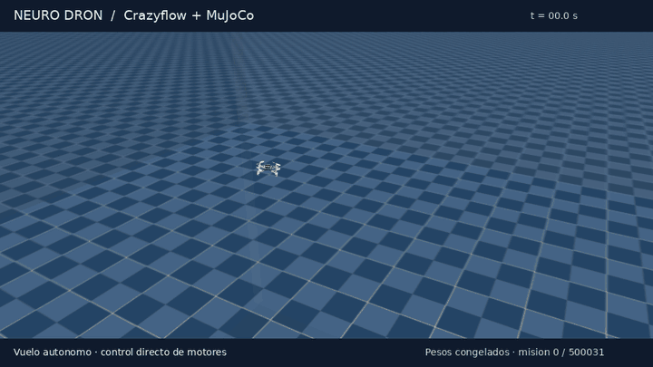

# Neuro Dron

Proyecto de investigación para entrenar drones autónomos mediante una implementación adaptada de **EGGROLL**, el método presentado en [Evolution Strategies at the Hyperscale](https://eshyperscale.github.io/).



*Vuelo del modelo de referencia en Crazyflow, visualizado con MuJoCo. Pesos congelados, sensores simulados y control directo de los motores.*

El objetivo es construir una base de entrenamiento que permita experimentar con una gama amplia de tamaños de red neuronal: desde modelos pequeños, adecuados para hardware limitado, hasta modelos grandes con los que explorar comportamientos más complejos. La motivación personal detrás del proyecto es crear un dron **lo más barato, pequeño, ágil y autónomo posible**.

**El proyecto está en desarrollo y actualmente se encuentra en la primera fase: entrenamiento en Crazyflow. La integración con un dron real y el perfeccionamiento en un simulador más realista siguen pendientes.**

## Motivación y método

Las estrategias evolutivas evalúan variaciones de los parámetros de una red y utilizan sus recompensas para actualizar el modelo. Permiten optimizar el comportamiento sin propagar gradientes a través del simulador.

[EGGROLL](https://eshyperscale.github.io/) introduce perturbaciones de bajo rango para reducir el coste de evaluar grandes poblaciones de modelos. El trabajo de referencia muestra mejoras importantes de eficiencia frente a estrategias evolutivas convencionales, especialmente con modelos grandes. Esa escalabilidad motiva su aplicación aquí, manteniendo también la posibilidad de entrenar redes pequeñas.

La implementación de este repositorio combina perturbaciones de bajo rango, pares de perturbaciones opuestas, recompensas transformadas por rango y actualizaciones con Adam. La mejora de rendimiento concreta en este entorno de drones debe medirse experimentalmente; los resultados del trabajo original no constituyen resultados de este proyecto.

## Detalles

Consulta los [detalles del proyecto](docs/DETALLES.md): el paso de la simulación al dron real, los modelos pequeños, las capacidades y limitaciones actuales, el benchmark y los próximos cambios.

## Instalación

Requiere **Python 3.10 o superior**. Desde la raíz del proyecto:

```bash
python -m venv .venv
source .venv/bin/activate
python -m pip install --upgrade pip
python -m pip install -e .
```

Las dependencias están declaradas en `pyproject.toml`, entre ellas JAX 0.6.2, Crazyflow 0.0.1, NumPy, MuJoCo y tensorboardX. Los comandos siguientes utilizan CPU; para usar `--device gpu` es necesario disponer de una instalación de JAX compatible con la GPU y sus controladores. También existe la opción `--device auto`.

## Uso básico

### Entrenamiento

Ejemplo de ejecución inicial con una población reducida y una red pequeña. Es un punto de partida para experimentar, no una configuración con convergencia garantizada:

```bash
python tools/train_direct.py \
  --output runs/primer_entrenamiento \
  --device cpu \
  --population 64 \
  --batch-worlds 16 \
  --generations 100 \
  --hidden-layers 64 64
```

La población debe ser par. `--population` controla el número de candidatos evolutivos, `--batch-worlds` el número de mundos procesados por lote y `--hidden-layers` el tamaño de las capas ocultas. Aumentar estos valores cambia las necesidades de memoria y cómputo. Usa un directorio de salida nuevo para cada experimento.

Para reanudar una ejecución conservando su configuración y presupuesto originales:

```bash
python tools/train_direct.py \
  --output runs/primer_entrenamiento \
  --resume runs/primer_entrenamiento/latest.pkl \
  --device cpu
```

En Linux con una sesión de usuario de systemd, `tools/train_safe.py` acepta los mismos argumentos y limita el entrenamiento a 12 GiB de RAM, sin swap y hasta dos CPU, además de impedir ejecuciones protegidas simultáneas.

### Evaluación y exportación

```bash
python tools/eval_direct.py runs/primer_entrenamiento/best.pkl \
  --output runs/evaluacion/informe.json \
  --device cpu \
  --episodes 20 \
  --sizes 1 4 8 \
  --export runs/evaluacion/export
```

La evaluación genera un informe y la exportación incluye los pesos (`policy.npz`), vectores de comprobación de inferencia y un manifiesto con las observaciones y acciones esperadas. Se puede añadir `--render` para visualizar un episodio en un entorno con soporte gráfico.

Consulta todas las opciones con `python tools/train_direct.py --help` y `python tools/eval_direct.py --help`.

### Pruebas

```bash
python tools/test_components.py
```

Este comando ejecuta los módulos de pruebas en procesos separados para liberar las cachés de JAX entre ellos.

## Estructura del proyecto

```text
src/drone_swarm/
├── direct/        # Piloto directo, entrenamiento, escenarios y exportación
├── learning/      # Red neuronal y estrategias evolutivas
├── simulation/    # Entorno físico, geometría y visualización
├── perception/    # Sensores y estimación
├── control/       # Utilidades de control compartidas
├── artifacts/     # Utilidades de modelos y checkpoints
├── config.py      # Configuración compartida
└── runtime.py     # Selección de CPU/GPU
tools/             # Entrenamiento, evaluación y ejecución de pruebas
tests/             # Pruebas de integración
```

Para más detalles sobre la organización, consulta [INDICE.md](INDICE.md).

## Referencia

[Evolution Strategies at the Hyperscale — EGGROLL](https://eshyperscale.github.io/), trabajo en el que se basa la adaptación del método para este proyecto.
